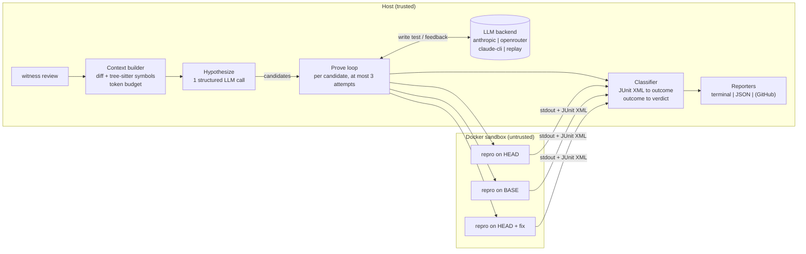

# Witness

**An AI code reviewer that only reports bugs it can prove.**

AI pull-request reviewers are noisy. They flag plausible-sounding problems that are not
real, so developers learn to ignore them. Witness takes the opposite trade: **precision
over recall**. Every finding it reports comes with evidence produced by execution, a test
that fails on the change and passes without it, run in an isolated sandbox. A hypothesis
that cannot be reproduced is dropped, however convincing it sounds.

> Status: milestone 1 (CLI against a local repo) plus the core of milestone 2 (hardened
> Docker sandbox, pytest and vitest runners). The GitHub App, eval harness and deployment
> are next. See [docs/spec.md](docs/spec.md).

## What it looks like

The repo ships a small invoicing project whose HEAD commit introduces two real bugs and
one harmless refactor. With recorded model responses the whole pipeline runs offline:

```text
$ witness review --repo .demo/demo-repo --base main --head float-discounts \
      --backend replay --fixtures fixtures/demo-repo/replay.json
Witness  b3bcf4d7 -> a5a672ab  |  python/pytest  |  replay (claude-opus-5-5)
2 verified   0 pre-existing   1 rejected   0 unverified   (from 3 hypotheses)

┌─ C1 VERIFIED  high  src/invoicing/dates.py:15-18 ──────────────────────────────────┐
│ iter_billing_days now loops while day < end, but end is inclusive ...              │
│ Evidence: failed on the declared assertion; the same test passes on BASE           │
│ Fails on HEAD with: AssertionError: assert Decimal('30.00') == Decimal('31.00')    │
│ Attempts: 1 assertion                                                              │
│ Repro test: ...                                                                    │
│ Suggested fix (verified: the repro passes with this patch)                         │
│ -    while day < end:                                                              │
│ +    while day <= end:                                                             │
└────────────────────────────────────────────────────────────────────────────────────┘
┌─ C2 VERIFIED  high  src/invoicing/money.py:20-21 ──────────────────────────────────┐
│ apply_discount now does the arithmetic in binary floats and rounds with round() ...│
│ Fails on HEAD with: AssertionError: assert Decimal('0.57') == Decimal('0.58')      │
│ Attempts: 1 test_error (ModuleNotFoundError) -> 2 assertion                        │
│ ...                                                                                │
└────────────────────────────────────────────────────────────────────────────────────┘
Not reported: hypotheses that failed verification
│ C3 │ rejected │ Invoice.subtotal now uses sum() ... returns the int 0 │ a well-formed repro
│    │          │ rather than a Decimal ...                             │ passed on HEAD ...
```

C3 is the point of the project. It is exactly the kind of comment a conventional AI
reviewer would post: specific, plausible, wrong (`sum()` is given `start=Decimal("0.00")`).
Witness wrote a test for it, the test passed on HEAD, and the claim was discarded.

## How it works



1. **Context.** `git diff BASE HEAD`, the changed files, and the enclosing function or
   class of every changed hunk (tree-sitter, Python and TypeScript), shown with HEAD line
   numbers. The test runner is detected from `pyproject.toml` / `package.json` and can be
   overridden by `.witness.yml`.
2. **Hypothesize.** One LLM call with a JSON schema returns candidate bugs (claim, file,
   line range, trigger, severity, confidence), validated with pydantic. Candidates outside
   the changed files are dropped.
3. **Prove.** For each candidate the model writes a minimal test and *declares in advance*
   how it will fail. Witness runs it in the sandbox on HEAD and classifies the result. If
   it failed for the declared reason, the same test runs on BASE. Otherwise the classified
   outcome goes back to the model, which can retry (up to 3 attempts) or concede.
4. **Fix (optional).** For a verified bug, the model proposes exact-match edits. Witness
   applies them to a scratch copy of HEAD and reruns the repro; the fix is marked
   verified only if the test now passes.
5. **Report.** Rich terminal output and a JSON document of the full `ReviewResult`
   (every attempt, test, outcome and fix). Reporters share one `Reporter` protocol, so a
   GitHub review reporter slots in next to them.

### What counts as proof

The verdict comes from deterministic code in [`classify.py`](src/witness/classify.py)
and [`prove.py`](src/witness/prove.py), never from the model's opinion of its own test.

| Test result on HEAD | Matches the declared failure? | Result on BASE | Status |
|---|---|---|---|
| assertion fails, or the declared exception is raised from a changed file | yes | passes | **verified** (regression) |
| same | yes | cannot run it (e.g. the code is new) | **verified** (new code) |
| same | yes | fails the same way | **pre-existing** (real bug, not caused by this change) |
| fails for a different reason | no | not run | retry, then **unverified** |
| import, syntax or name error, fixture error, skip, or an exception raised by the test's own body | no | not run | retry, then **unverified** |
| passes | no | not run | retry or concede, then **rejected** |

Only *verified* findings are reported in full. Rejected and pre-existing ones get one line
each; unverified ones are hidden unless `--show-unverified` is given.

## Sandbox security model

Everything from the repository under review, and everything the model writes, is
untrusted. The model never gets a shell: it only produces text (a test file, a list of
edits) that Witness places into a container.

| Control | How |
|---|---|
| No network | `network_mode=none` for every test run |
| Resource limits | 1 CPU, 1 GiB memory with no extra swap, 256 PIDs, 120 s wall clock (`--timeout`), then `docker kill` |
| Host filesystem | the source snapshot is bind-mounted **read-only** at `/repo` and copied into a 512 MiB `tmpfs` at `/work`; the repro file is a separate read-only mount. No host path is writable from inside. |
| Container | read-only root filesystem, `noexec` tmpfs mounts, `cap_drop=ALL`, `no-new-privileges`, unprivileged uid 10001 |
| Output | capped at 200 KB inside the container and again on the host |
| Snapshots | `git archive` of the exact commit, extracted with tarfile's `data` filter (no absolute paths, `..` escapes, devices or outward links); no `.git`, no untracked files |
| Dependencies | installed once into an image tagged by a hash of the Dockerfile and all dependency manifests and lockfiles. The build context holds **only those manifests**, never repo code; npm runs with `--ignore-scripts`. |
| Model edits | fix edits must target existing files inside the snapshot (resolved-path check), must match exactly once, may not touch the repro, and are applied to a scratch copy |
| Prompt injection | repo content is wrapped in `<repository>` tags and labelled as data; and since verdicts come from execution, a manipulated model can at worst fail to prove a bug |

Known limits, stated plainly:

- Dependency installation (`pip install`) has network access and may run package build
  hooks from PyPI. It never runs code from the repository under review.
- Code inside the container controls its own output, so a hostile repository could forge
  a "pass" or "fail" for its own review. Isolation protects the host, not the verdict on an
  adversarial repo.
- Docker shares the host kernel. For hostile multi-tenant use (the future GitHub App),
  the plan is gVisor (`--runtime=runsc`) or Firecracker microVMs.

## Context budget

The model sees sections in priority order: project summary and file list, the diff (one
section per file), the enclosing symbols of each hunk, then the full HEAD text of each
changed file. Sections are added greedily against the token budget (`--budget-tokens`,
default 60k, estimated at 4 characters per token). The first section that does not fit
is cut at a line boundary with a `[truncated: N more lines]` marker, and every later
section is named in an "Omitted" footer whose cost also comes out of the budget. Higher
layers summarize lower ones, so what survives is the most useful view of the change.

## Running it

Requirements: Python 3.13, [uv](https://docs.astral.sh/uv/), git, and Docker.

```bash
uv sync --all-extras                                    # includes the tracing extra
```

### Offline demo (no API key)

```bash
uv run python fixtures/demo-repo/build_demo_repo.py     # builds .demo/demo-repo
uv run witness review --repo .demo/demo-repo --base main --head float-discounts \
    --backend replay --fixtures fixtures/demo-repo/replay.json --json .demo/result.json
```

The first run builds the dependency image (about a minute); later runs reuse it and take
a few seconds. The demo's git history is generated by a script with fixed authors and
dates, so the commit hashes are identical on every machine and no nested `.git` is
committed.

The replay fixture was written by hand in the same format a live run records with
`--record`. The demo therefore shows Witness's own machinery (sandbox, classification,
verdicts, fix verification) running for real, not the quality of a particular model.

### Against a real change

```bash
export ANTHROPIC_API_KEY=...
uv run witness review --repo ../some-repo --base main --head my-branch
uv run witness review ... --backend openrouter            # OPENROUTER_API_KEY
uv run witness review ... --backend claude-cli            # local `claude -p`, dev only
uv run witness review ... --record run.json               # save replies for --backend replay
```

The Anthropic backend defaults to `claude-opus-5-5` with JSON-schema structured output,
prompt caching of the shared repo context, and server-side refusal fallback enabled.

### `.witness.yml`

```yaml
language: python                  # python | typescript
runner: pytest                    # pytest | vitest  (jest is detected but not run yet)
test_command: python -m pytest -p no:randomly   # base command; Witness appends the repro path and report flags
```

### Tracing

With the `tracing` extra (the Tracewright SDK, a sibling project, via a uv path source)
and `TRACEWRIGHT_API_KEY` set, each review is recorded as a trace:

```text
witness review > hypothesize > chat claude-opus-5-5
               > candidate C2 > attempt 1 > chat, sandbox exec head
                              > attempt 2 > chat, sandbox exec head, sandbox exec base
                              > fix > chat, sandbox exec fix
```

Without the extra, the import is guarded and every span is a no-op.

## Development

```bash
uv run ruff check . && uv run ruff format --check .
uv run mypy                       # strict, src and tests
uv run pytest                     # everything; needs Docker for the integration tests
uv run pytest -m "not integration"
```

Tests never call a real LLM. The unit tests drive the prove loop with the replay backend
and a scripted sandbox; the integration tests use real Docker for the sandbox's isolation
properties (uid, read-only mounts, no network, timeout kill), the vitest runner, and the
full demo review, including its trace tree.

## Layout

```text
src/witness/
  cli.py            argument parsing, wiring, exit codes
  review.py         the pipeline: snapshots, context, hypothesize, prove
  context.py        prompt context and the token budget
  symbols.py        tree-sitter: enclosing functions and classes of changed lines
  project.py        language and runner detection, .witness.yml
  hypothesize.py    stage 1: candidate bugs
  prove.py          stage 2: the bounded attempt loop, verdicts, fix verification
  classify.py       JUnit XML to outcome, outcome to "proved or not" (pure)
  prompts.py        all prompt text
  models.py         Candidate, TestOutcome, Attempt, Finding, ReviewResult
  llm/              backend protocol, anthropic, openrouter, claude-cli, replay/record
  sandbox/          Docker sandbox, cached dependency images, pytest and vitest runners
  report/           Reporter protocol, terminal and JSON reporters
  tracing.py        optional Tracewright spans
fixtures/demo-repo/ base/ and head/ trees, the history builder, recorded responses
```
